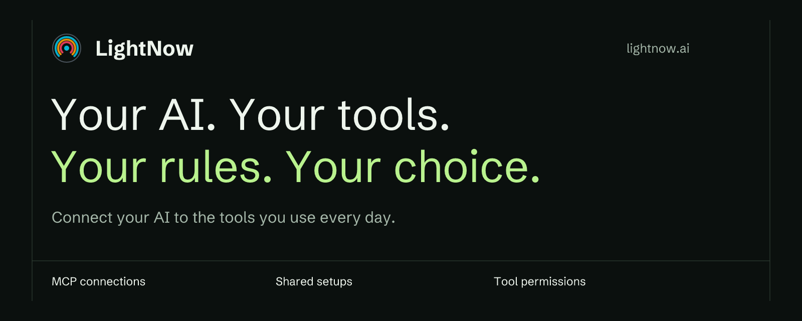

Connect your AI assistants to the tools and knowledge you work with through
the **Model Context Protocol (MCP)**. Bring your connections into one setup,
use it in supported clients such as Codex, Claude and Cursor, and choose which
actions your AI may take.

[Get started](https://docs.lightnow.ai/getting-started/github-with-codex/)
· [Explore the product](https://lightnow.ai/features)
· [Browse MCP servers](https://lightnow.ai/servers)

## One setup. Your choice of AI assistant.

- **Connect your tools.** Find public MCP servers, inspect their tools and
  versions, and add your own private servers.
- **Share a working setup.** Runtime profiles bring server connections and
  settings together. Start with personal profiles; Team adds shared profiles
  and company sign-in.
- **Set the rules.** Enterprise adds individual tool allow and deny policies.
  In the managed Proxy path, LightNow checks the policy before forwarding a
  call to the MCP server.
- **Understand what ran.** Enterprise runtime analysis shows reported calls,
  errors and duration. It requires compatible clients with reporting enabled.

LightNow is vendor-neutral and hosted in Germany. Compare the full capabilities
and requirements on the [pricing page](https://lightnow.ai/pricing).

## Try GitHub in Codex

[Connect a repository and ask about its open issues](https://docs.lightnow.ai/getting-started/github-with-codex/).
The guide covers installation, GitHub access, keeping existing MCP connections,
and verifying the result.

On macOS, install the local tools and sign in:

```bash
brew tap lightnow-ai/tap
brew install lightnow-cli lightnow-proxy
lightnow login
```

Before syncing, add GitHub to your Runtime profile and configure repository
access. If Codex already has MCP connections you want to keep, preview and
import them first with `lightnow import-config --client codex --dry-run` and
`lightnow import-config --client codex`. Proxy sync replaces direct MCP entries
with one LightNow entry and keeps a backup.

Then connect the profile:

```bash
lightnow sync --client codex --profile default --local-proxy
```

Restart Codex, start a new session and verify that the GitHub tools are
available. Follow the [full guide](https://docs.lightnow.ai/getting-started/github-with-codex/)
for connection checks, other installation methods and troubleshooting.

## Open-source tools

| Project | Purpose |
| --- | --- |
| [LightNow CLI](https://github.com/lightnow-ai/lightnow-cli) | Sign in, manage Runtime profiles and sync connections to supported AI clients. |
| [LightNow Proxy](https://github.com/lightnow-ai/lightnow-proxy) | Run alongside your AI client and connect it to local or reachable MCP servers. |
| [Homebrew tap](https://github.com/lightnow-ai/homebrew-tap) | Install the CLI and Proxy on macOS. |

LightNow is a product by **ApiTree**.

[Website](https://lightnow.ai)
· [Documentation](https://docs.lightnow.ai/)
· [MCP Weekly](https://lightnow.ai/weekly)
· [APITree on LinkedIn](https://www.linkedin.com/company/apitree/)
